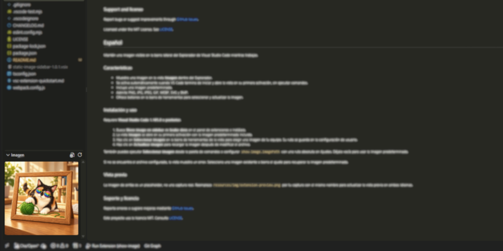

# Show Image

[English](#english) | [Español](#español)

## English

Keep an image visible in the Visual Studio Code Explorer sidebar while you work.

### Features

- Displays an image in the **Imagen** view inside the Explorer.
- Activates automatically when VS Code finishes starting and opens the view on its first activation, without running commands.
- Includes a default image.
- Supports PNG, JPG, JPEG, GIF, WEBP, SVG, and BMP.
- Provides toolbar buttons to select and refresh the image.

### Installation and usage

Requires **Visual Studio Code 1.105.0 or later**.

1. Search for **Show image on sidebar** by **krake-devs** in the Extensions panel and install it.
2. The **Imagen** view opens on its first activation with the included default image.
3. Click **Select Image** in the view toolbar to choose an image from your computer. Its path is saved in your user settings.
4. Click **Refresh Image** to reload the image after changing the file.

You can also run **Select Image** from the Command Palette or configure `show-image.imagePath` with an absolute file path in Settings. Leave it empty to use the default image.

If the configured file cannot be found, the view displays an error. Select an existing image or clear the setting to restore the default image.

### Preview

The image above is a placeholder, not an actual screenshot. Replace `resources/img/extension-preview.png` with your screenshot using the same filename to update the preview for both languages.

### Support and license

Report bugs or suggest improvements through [GitHub Issues](https://github.com/tanzerKrake/show-image/issues).

Licensed under the MIT License. See [LICENSE](./LICENSE).

## Español

Mantén una imagen visible en la barra lateral del Explorador de Visual Studio Code mientras trabajas.

### Características

- Muestra una imagen en la vista **Imagen** dentro del Explorador.
- Se activa automáticamente cuando VS Code termina de iniciar y abre la vista en su primera activación, sin ejecutar comandos.
- Incluye una imagen predeterminada.
- Admite PNG, JPG, JPEG, GIF, WEBP, SVG y BMP.
- Ofrece botones en la barra de herramientas para seleccionar y actualizar la imagen.

### Instalación y uso

Requiere **Visual Studio Code 1.105.0 o posterior**.

1. Busca **Show image on sidebar** de **krake-devs** en el panel de extensiones e instálala.
2. La vista **Imagen** se abre en su primera activación con la imagen predeterminada incluida.
3. Haz clic en **Select Image** en la barra de herramientas de la vista para elegir una imagen de tu equipo. Su ruta se guarda en la configuración de usuario.
4. Haz clic en **Refresh Image** para recargar la imagen después de modificar el archivo.

También puedes ejecutar **Select Image** desde la paleta de comandos o configurar `show-image.imagePath` con una ruta absoluta en Ajustes. Déjala vacía para usar la imagen predeterminada.

Si no se encuentra el archivo configurado, la vista muestra un error. Selecciona una imagen existente o borra el ajuste para recuperar la imagen predeterminada.

### Vista previa

La imagen de arriba es un placeholder, no una captura real. Reemplaza `resources/img/extension-preview.png` por tu captura con el mismo nombre para actualizar la vista previa en ambos idiomas.

### Soporte y licencia

Reporta errores o sugiere mejoras mediante [GitHub Issues](https://github.com/tanzerKrake/show-image/issues).

Este proyecto usa la licencia MIT. Consulta [LICENSE](./LICENSE).
